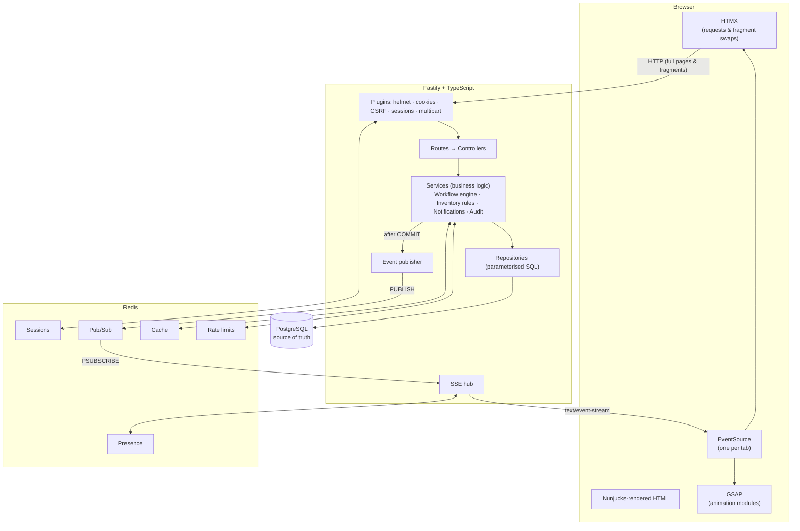
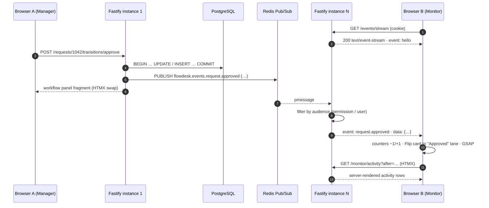
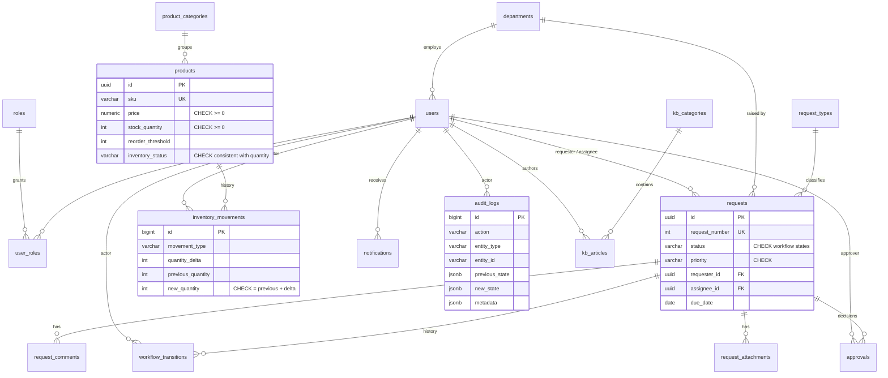
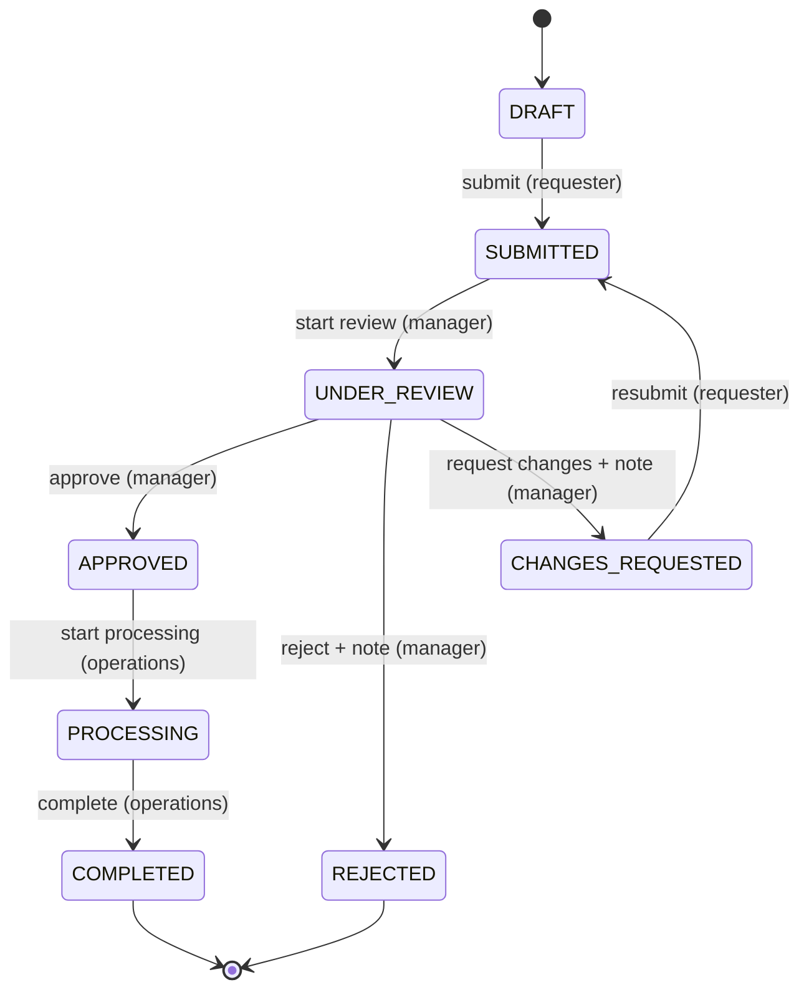

# FlowDesk

**Business workflows, operations and real-time monitoring in one platform — built without a frontend SPA framework.**

FlowDesk is a full-stack business operations platform. Employees raise requests (equipment, purchases, IT access, travel…), managers review and approve them through a validated workflow engine, operations staff fulfil them and keep inventory honest, and everyone sees changes **live** on a real-time monitor.

The project is a portfolio piece that shows a serious application can be built with a **server-driven architecture**:

```text
Nunjucks → HTML → HTMX → Fastify + TypeScript → business logic → PostgreSQL
```

while real-time features use:

```text
Business event → Redis Pub/Sub → Server-Sent Events → browser → HTMX / DOM events → GSAP
```

No React, Vue, Angular, Svelte, Next.js, Redux or client-side state library is used. The browser receives HTML.

---

## Contents

- [Features](#features)
- [Quick start](#quick-start)
- [Demo accounts & the real-time scenario](#demo-accounts--the-real-time-scenario)
- [Architecture](#architecture)
- [Technology choices](#technology-choices)
- [Real-time architecture](#real-time-architecture)
- [Where data lives: PostgreSQL vs Redis](#where-data-lives-postgresql-vs-redis)
- [Database](#database)
- [Authentication & sessions](#authentication--sessions)
- [Authorization](#authorization)
- [Workflow engine](#workflow-engine)
- [Inventory rules](#inventory-rules)
- [Frontend: Nunjucks, HTMX & GSAP](#frontend-nunjucks-htmx--gsap)
- [Security](#security)
- [Observability](#observability)
- [Testing](#testing)
- [Local development](#local-development)
- [Deployment](#deployment)
- [Project structure](#project-structure)

---

## Features

| Area | What it does |
| --- | --- |
| **Requests** | Create, edit, delete, search, filter, sort and paginate requests; comments; attachments; assignment; status changes — all through HTMX fragments |
| **Workflow engine** | Explicit TypeScript state machine (`DRAFT → SUBMITTED → UNDER_REVIEW → APPROVED → PROCESSING → COMPLETED`, plus `REJECTED` and `CHANGES_REQUESTED → SUBMITTED`), validated on the server inside a transaction |
| **Monitor Real-Time** | Live counters, workflow lanes, inventory watch, movement feed and audit stream, updated over SSE with a `LIVE / RECONNECTING / OFFLINE` indicator |
| **Products & inventory** | Catalogue CRUD, search/filter/sort/pagination, grid & table views, product detail with live stock, inventory movements & history, threshold alerts |
| **Notifications** | Persisted in PostgreSQL, delivered instantly via Redis + SSE; unread badge, drawer, mark read, remove |
| **Audit logs** | Written by services in the same transaction as the change; searchable by text, user, entity, action and date |
| **Knowledge Center** | 18 articles across 5 categories, PostgreSQL full-text search with ranked, highlighted snippets, related articles, table of contents |
| **Overview** | Executive dashboard: key figures, 14-day volume sparkline, workflow summary, inventory attention, recent activity |
| **Accounts & admin** | Registration, login, logout, profile, password change, active-session management; user & role administration; system settings |
| **Landing page** | GSAP showcase: split-text hero, live console loop, pinned scroll-scrubbed workflow, inventory demo, animated stats |

---

## Quick start

### With Docker (recommended)

```bash
docker compose up --build -d
docker compose run --rm app node dist/db/cli/seed.js   # load the demo data
open http://localhost:3000
```

### Without Docker

Requires Node.js 20.11+, PostgreSQL 14+ and Redis 6+.

```bash
cp .env.example .env          # adjust DATABASE_URL / REDIS_URL if needed
npm install
npm run db:migrate
npm run db:seed
npm run dev                   # http://localhost:3000
```

---

## Demo accounts & the real-time scenario

All seeded accounts use the password in `SEED_PASSWORD` (`FlowDesk!2026` by default). The sign-in page has one-click buttons for these in development.

| Role | Email | Notes |
| --- | --- | --- |
| Employee | `sinta.wirawan@arunika.co.id` | Owner of request **#1042** |
| Manager | `raka.pratama@arunika.co.id` | Finance Manager — can approve #1042 |
| Operations | `dewi.lestari@arunika.co.id` | Processes requests, records stock movements |
| Admin | `admin@arunika.co.id` | Users, roles, products, audit logs, settings |

The seed creates 25 users across 9 departments, 56 requests in every workflow state with full history, 34 products in 11 categories with movement history, comments, ~300 notifications, ~570 audit entries and 18 Knowledge Center articles. The organisation (Arunika Group) and everyone in it are fictional.

### Try it: approve #1042 and watch it land live

1. **Browser A** — sign in as **Raka (Manager)** and open `/requests/1042` (*Laptop for new finance analyst*, `UNDER_REVIEW`).
2. **Browser B** — sign in as **Dewi (Operations)** and open **Monitor Real-Time**. The pill shows `● LIVE`.
3. In Browser A click **Approve**.
4. Browser B updates without a reload:
   - **Pending approvals** counts down (e.g. 15 → 14) and **Approved today** counts up (3 → 4) with a delta flag,
   - the **#1042** card Flip-animates from *Under review* to *Approved*,
   - a new line appears in the audit stream, and Sinta gets a notification.

### Inventory: 10 → 9 → 0

1. Keep the monitor open in Browser B.
2. In another tab open **Products → Toner Cartridge TN-760** (10 in stock, reorder at 3).
3. Record an issue of 1 (**10 → 9**, still `IN_STOCK`), then issue 6 (**9 → 3**, `LOW_STOCK`), then 3 (**3 → 0**, `OUT_OF_STOCK`).
4. The stock number tweens, the status badge changes, the panel shakes on threshold crossings, the monitor's *Low stock* / *Out of stock* counters and inventory watch update live, and operations staff receive notifications. Issuing one more unit is rejected — stock can never go negative.

---

## Architecture



**Layering.** Routes declare URLs and authorization hooks; controllers translate HTTP (full page vs HTMX fragment, redirects, toasts) and call services; services own all business rules and transactions; repositories hold SQL. Templates contain presentation only.

**One request through the stack** (manager approves #1042):

```text
POST /requests/1042/transitions/approve      (HTMX, X-CSRF-Token header)
 → auth plugin: Redis session → principal + permissions from PostgreSQL
 → CSRF + Origin check
 → RequestService.transition()
     BEGIN
       SELECT … FOR UPDATE                    (row lock — no concurrent transitions)
       workflow engine: UNDER_REVIEW --approve--> APPROVED ? actor has request:review ?
       UPDATE requests · INSERT workflow_transitions · INSERT approvals
       INSERT audit_logs · INSERT notifications
     COMMIT
     PUBLISH flowdesk.events.request.approved, flowdesk.events.notification.created
 → controller renders partials/workflow/refresh.njk (panel + out-of-band badge & history)
 → HX-Trigger: toast
```

---

## Technology choices

| Technology | Why |
| --- | --- |
| **TypeScript** | One language for server, tests and browser code; the workflow table, event model and permissions are typed, so an illegal status or event name is a compile error. |
| **Fastify** | Fast, plugin-based and encapsulated: hooks make "every route in this scope requires `audit:read`" a one-liner; first-class logging via pino; `inject()` makes integration tests cheap. |
| **Nunjucks** | Mature server-side templating with layouts, blocks, macros and includes — enough to build a component system (buttons, badges, tables, modals, pagination) without a JS framework. Autoescaping on by default. |
| **HTMX** | Turns links and forms into AJAX requests that return HTML. Search, filters, pagination, comments, uploads, workflow actions and modals all work by swapping server-rendered fragments. Progressive enhancement: the same URLs render full pages. |
| **GSAP** | Precise, interruptible timelines, `ScrollTrigger` and `Flip` give purposeful motion (lane moves, number tweens, threshold alerts) that cooperates with DOM swaps instead of owning the DOM. |
| **PostgreSQL** | The source of truth: relational integrity, `CHECK` constraints that mirror business rules, transactions, row locks, `FOR UPDATE`, generated `tsvector` columns and GIN indexes for search. |
| **Redis** | Purpose-built for ephemeral, high-speed concerns: sessions with TTL, Pub/Sub fan-out between app instances, atomic rate-limit counters, read-through cache, presence. |
| **SSE** | Server → browser push over plain HTTP: automatic reconnection, works through proxies, needs no extra protocol. Real-time here is one-directional (commands go through normal HTTP), so WebSockets would add complexity without benefit. |

---

## Real-time architecture



- **Event model** (`src/events/types.ts`) — a typed discriminated union: `request.created|submitted|review_started|approved|rejected|changes_requested|processing_started|completed|assigned|updated|deleted|commented`, `product.created|updated|deleted`, `inventory.changed|low|out`, `notification.created`. Each event carries `id`, `type`, `entityId`, `actorId`, `timestamp` and structured fields, e.g.

  ```json
  { "type": "inventory.changed", "entityId": "…", "productId": "…", "sku": "PRN-TN-760",
    "previousQuantity": 10, "newQuantity": 9, "previousStatus": "IN_STOCK", "newStatus": "IN_STOCK",
    "timestamp": "2026-10-08T03:12:44.120Z" }
  ```

- **Publishing after commit.** Services collect events while the transaction runs and publish them only after `COMMIT`, so subscribers never see a change that was rolled back. Publishing is separate from route handlers (`RedisEventPublisher`).
- **Audience routing.** Every event has an `audience` (`all`, specific users, or a permission plus the people involved). The SSE hub filters per connection and strips the audience before sending, so an employee never receives events about other people's requests or notifications.
- **Scale-out.** Each app instance holds one `PSUBSCRIBE flowdesk.events.*` connection and serves its own SSE clients, so any instance can publish and every connected browser receives the event.
- **Resilience.** Heartbeat comments every 25 s keep proxies from closing streams; the stream re-checks the session every 30 s and closes on logout/expiry; the browser's `EventSource` reconnects automatically, the UI shows `RECONNECTING`, and after reconnecting live pages re-fetch their state from PostgreSQL (`fd:resync`). A Redis outage degrades live updates but never loses data.
- **In the browser** (`client/realtime/sse.ts`) each event is re-dispatched as a DOM `CustomEvent`. Page modules update the DOM surgically, fetch **server-rendered fragments** through `htmx.ajax()` when new markup is needed (a new lane card, an activity row), and animate with GSAP. No client-side templates.

---

## Where data lives: PostgreSQL vs Redis

| Data | Store | Why |
| --- | --- | --- |
| Users, roles, departments | PostgreSQL | Durable identity; foreign keys everywhere |
| Requests, comments, attachments metadata, workflow transitions, approvals | PostgreSQL | Business records with full history |
| Products, categories, inventory movements | PostgreSQL | Stock must be consistent and auditable |
| Notifications | PostgreSQL | Users expect them to persist |
| Audit logs | PostgreSQL | Append-only compliance record |
| Knowledge Center, system settings | PostgreSQL | Content and configuration |
| Uploaded files | Private disk volume | Outside the web root, random keys, served only through authorised routes |
| Sessions (hashed id → user, CSRF token) | Redis, TTL | Fast lookup on every request; expiry handled by Redis |
| Session index per user | Redis set | "Sign out everywhere" on password/role change or deactivation |
| Flash messages | Redis, 60 s TTL | Genuinely short-lived |
| Event distribution | Redis Pub/Sub | Fan-out across instances; nothing to persist |
| Rate-limit counters | Redis `INCR`/`EXPIRE` (Lua) | Atomic and shared across instances |
| Categories, request types, departments, settings, landing stats | Redis cache | Read-heavy, rarely changing; invalidated on write |
| Live connections ("N live") | Redis sorted set | Ephemeral presence |

Redis is never the source of truth: flushing it signs everyone out and empties caches — nothing else.

---

## Database



Highlights (`migrations/001_initial_schema.sql`):

- **Constraints mirror business rules**: `products_inventory_status_consistent` makes it impossible to store `LOW_STOCK` with 50 units; `stock_quantity >= 0`; `new_quantity = previous_quantity + quantity_delta`; status/priority/role enums; lower-case unique emails.
- **Indexes for common queries**: request status, requester, assignee, created date, department; product SKU (unique), category, inventory status; partial index on unread notifications; audit timestamp, actor, entity and action; GIN indexes for full-text search on requests, products and articles (`tsvector` generated column).
- **Transactions & locking**: every multi-record change runs in `withTransaction()`; workflow transitions and stock movements take a `SELECT … FOR UPDATE` row lock so concurrent clicks cannot double-apply.
- **Migrations**: forward-only SQL files applied once each, inside a transaction, under a PostgreSQL advisory lock (safe for rolling deploys).

---

## Authentication & sessions

- **Passwords** are hashed with **scrypt** (N=2¹⁵, r=8, 16-byte salt; parameters stored in the hash so they can be raised later). Unknown emails still pay a hash comparison to keep timing uniform.
- **Sessions** are server-side in Redis. The browser holds only a 256-bit random id in an **HTTP-only, SameSite=Lax** cookie (`Secure` and the `__Host-` prefix behind HTTPS). Redis stores a **SHA-256 of the id**, so a Redis dump cannot be replayed as cookies.
- **Expiry**: an 8-hour sliding idle timeout (Redis TTL) and a 7-day absolute lifetime. Logout deletes the session; password changes sign out all other sessions; role changes and deactivation revoke the user's sessions. The Account page lists active sessions (device, IP, last seen) with per-session sign-out.
- **Rate limiting** (Redis): sign-in per IP and per account, registration per IP, password change, uploads and inventory movements.
- Tokens are never placed in `localStorage`; the session id never reaches JavaScript.

## Authorization

Roles (`EMPLOYEE`, `MANAGER`, `OPERATIONS`, `ADMIN`) live in PostgreSQL and map to permissions in one place (`src/auth/permissions.ts`). The principal and permissions are **loaded from PostgreSQL on every request** — nothing about identity, role, workflow status or stock comes from the browser.

| Role | Can |
| --- | --- |
| Employee | create, submit, edit (draft / changes requested), delete drafts, comment, upload — own requests only |
| Manager | everything above + see all requests, start review, approve, reject, request changes, assign |
| Operations | see all requests, start processing, complete, record inventory movements |
| Admin | everything, including users & roles, products, audit logs and settings |

Checks happen at two levels: route scopes (`requirePermission('audit:read')`) and services (visibility of a specific request, ownership of a draft, the workflow engine's actor rules). Requests you may not see return **404**, not 403, so their existence is not leaked. Hiding a button is never the security boundary.

---

## Workflow engine

The workflow is data (`src/workflow/definition.ts`):

```ts
export const allowedTransitions = {
  DRAFT: ['SUBMITTED'],
  SUBMITTED: ['UNDER_REVIEW'],
  UNDER_REVIEW: ['APPROVED', 'REJECTED', 'CHANGES_REQUESTED'],
  CHANGES_REQUESTED: ['SUBMITTED'],
  APPROVED: ['PROCESSING'],
  PROCESSING: ['COMPLETED'],
  REJECTED: [],
  COMPLETED: [],
};
```



Each rule names its **action**, its **actor** (the requester, or a permission) and whether a **note is required**. The browser sends only an action name; `evaluateTransition()` decides the target status from the **locked, persisted** status and the actor's permissions, returning `INVALID_TRANSITION` (409), `FORBIDDEN` (403) or `NOTE_REQUIRED` (422). Every successful transition, in one transaction: updates the request, records the transition (and the approval decision), writes an audit entry and creates notifications — then publishes the Redis event.

## Inventory rules

`src/inventory/rules.ts` is pure and unit-tested:

```text
quantity > reorderThreshold           → IN_STOCK
0 < quantity <= reorderThreshold      → LOW_STOCK
quantity == 0                         → OUT_OF_STOCK
```

Movements are `RECEIPT` (+), `ISSUE` (−), `RETURN` (+) and `ADJUSTMENT` (absolute stock count, reason required). A movement that would go negative is rejected by the service **and** by a database constraint. Stock only changes through movements, so history is complete. Crossing into a worse band publishes `inventory.low` / `inventory.out` and notifies operations and admins (configurable in Settings).

---

## Frontend: Nunjucks, HTMX & GSAP

### Nunjucks

```text
views/
├── layouts/      base.njk (document) · app.njk (shell) · public.njk
├── pages/        one template per page (overview, monitor, requests/…, products/…, knowledge/…)
├── components/   macros: ui (buttons, badges, stats, alerts, empty states, modal, meters),
│                 forms, table (sortable headers), pagination, icons, product-art
└── partials/     HTMX fragments: requests/ products/ monitor/ notifications/ workflow/ …
```

Presentation helpers (date/money filters, status metadata, the workflow stepper view model) are computed in TypeScript and exposed as filters/globals. Templates never decide permissions or business outcomes.

### HTMX

- **Full pages for navigation, fragments for interactions.** `hx-boost` turns navigation into AJAX page swaps. Search, filters, sorting and pagination use `hx-get` + `hx-target` + `hx-push-url` and return only the results region (`wantsFragment(req, 'request-results')`).
- Demonstrated attributes: `hx-get`, `hx-post`, `hx-put`, `hx-delete`, `hx-target`, `hx-swap` (incl. `outerHTML`, `beforeend`, `afterbegin`, swap delays), `hx-trigger` (`input changed delay:300ms`, `change`), `hx-push-url`, `hx-indicator`, `hx-encoding` (uploads), `hx-vals`, `hx-disabled-elt`, out-of-band swaps (`hx-swap-oob`).
- Server → client signals use `HX-Trigger` (toasts, unread counts, closing modals), `HX-Location` (redirects), `HX-Retarget`/`HX-Reswap` (validation errors inside a modal).
- `422` responses are swapped (forms re-render with field errors); other errors are not swapped and surface as a toast from `X-Error-Message`.
- CSP-friendly: `allowEval: false`, no inline scripts, no `hx-on`.

### GSAP animation system

```text
client/animations/
├── pageEnter.ts     split-word headline reveal, card stagger
├── pageExit.ts      exit fade during the boosted swap delay + top progress bar
├── cardReveal.ts    ScrollTrigger.batch reveals for [data-reveal="card"]
├── listUpdate.ts    result-list stagger, [data-animate="enter"] inserts, animated removals
├── scrollReveal.ts  scroll-triggered content sections (articles)
├── modal.ts         cream dialog in/out
├── notification.ts  toasts, badge pop, bell ring
├── workflow.ts      stepper progression, status flip, timeline cascade
├── product.ts       product image entrance, detail reveal, card tilt
├── inventory.ts     stock number transition, badge/meter update, threshold alert
└── numbers.ts       number tweens, count-up, delta flags
```

Behaviour is attached with `data-module="…"` and managed by a small registry (`client/core/registry.ts`): modules initialise once per element after each `htmx:afterSettle`, and their cleanup (listeners, intervals, `gsap.context().revert()`, ScrollTriggers) runs when HTMX removes the element — no leaks, no double initialisation. `prefers-reduced-motion` short-circuits every animation to its final state.

The design language — ink & aurora backdrop, liquid-glass surfaces, cream "3D" dialogs, Bricolage Grotesque / Geist typography — follows the provided design reference. Fonts and libraries are self-hosted (no CDN), so the strict CSP stays intact.

---

## Security

| Concern | Measure |
| --- | --- |
| Passwords | scrypt with per-password salt; constant-time comparison |
| Sessions | Redis-backed, HTTP-only, SameSite=Lax, Secure/`__Host-` behind HTTPS, hashed at rest, idle + absolute expiry, rotation on login, invalidation on logout / password / role change |
| CSRF | Per-session synchronizer token (HTMX header via `hx-headers`, hidden `_csrf` in plain forms), Origin check on every state-changing request, SameSite cookies |
| Authorization | Server-side permission checks on every route and inside services; 404 for invisible records; ownership checks; workflow actor rules |
| Input validation | zod schemas for every input; enums and ids validated; sort columns whitelisted |
| SQL injection | Parameterised queries only |
| Output escaping | Nunjucks autoescape; the Markdown renderer escapes all HTML before adding a fixed tag set and only allows internal/`https` links; toasts and dialogs use `textContent` |
| Headers | Helmet: strict CSP (`script-src 'self'`, no eval), `frame-ancestors 'none'`, nosniff, referrer policy, HSTS behind HTTPS |
| Rate limiting | Redis-backed limits on sign-in (per IP and per account), registration, password change, uploads, inventory movements |
| File uploads | Extension allow-list **and** magic-byte sniffing must agree; size limit; sanitised display names; stored outside the web root under random UUID keys; `0600` permissions |
| File downloads | Only through `/attachments/:id/download` after checking the user can see the request; `Content-Disposition`, `nosniff` and a sandboxing CSP |
| Open redirects | `next=` and notification links restricted to same-site relative paths |
| Browser-supplied data | User ids, roles, permissions, workflow status and stock quantities are never trusted — they are always read from PostgreSQL |
| Secrets | Configuration from environment variables, validated at boot; `.env` is git-ignored; logs redact cookies, passwords and tokens |

---

## Observability

Structured JSON logs via pino (pretty-printed in development), with request ids. Logged: authentication failures (with reason, never the password), access denials, workflow transitions, product and inventory changes, Redis connection errors/reconnects, SSE write failures, CSRF mismatches and unexpected errors (with stack traces server-side only). A redaction list strips `cookie`, `authorization`, `x-csrf-token`, `set-cookie` and any `password`/`passwordHash`/`sessionId`/`csrfToken` field. `GET /healthz` checks PostgreSQL and Redis and reports connected SSE clients.

---

## Testing

```bash
npm test             # all suites (needs PostgreSQL + Redis)
npm run test:unit    # pure unit tests, no infrastructure
```

Integration tests run the real Fastify app (`app.inject()` and a real listening server for SSE) against PostgreSQL (`TEST_DATABASE_URL`, default `flowdesk_test`) and Redis (`TEST_REDIS_URL`, default DB 1). Each suite migrates and seeds a fresh database.

| Suite | Covers |
| --- | --- |
| `unit/workflow` | valid & invalid transitions, completed/rejected are final, actor rules, required notes, available actions |
| `unit/inventory` | status thresholds, never negative, low/out transitions, the 10 → 9 → 0 scenario, adjustments |
| `unit/permissions` | role → permission mapping |
| `unit/events` | event creation, audiences, SSE wire format, publisher channels & failure handling, hub fan-out/filtering |
| `unit/security-utils` | password hashing, Markdown escaping & link safety, filename sanitising, magic-byte detection, redirect safety |
| `integration/auth` | login, hashed session ids, invalid credentials, deactivated accounts, rate limiting, anonymous redirects, logout invalidation, CSRF & Origin checks, password change revoking sessions, idle and absolute session expiration |
| `integration/authorization` | employee cannot approve, manager can, operations cannot, hidden requests (404), list scoping, admin areas, role smuggling on registration, notification ownership |
| `integration/workflow` | full happy path with transitions, approvals, audit, notifications and events; completed cannot return to draft; invalid transitions; notes & changes loop; edit/delete/assign rules |
| `integration/products` | create, validation, duplicate SKU, update & status re-derivation, delete, delete protection, role checks; inventory never negative (service and DB), 10 → 9 → 3 → 0 with events/notifications/audit, adjustment reasons |
| `integration/realtime` | committed transition → Redis → SSE stream; inventory events over SSE; per-user notification delivery; anonymous streams rejected; hub ↔ real Redis subscription |
| `integration/attachments` | upload, safe names, random storage keys, authorised download, type/magic-byte rejection, size limit, cross-user protection |

CI (`.github/workflows/ci.yml`) runs lint, format check, type checks (server + client), build and the full test suite against PostgreSQL 16 and Redis 7 service containers, then builds the Docker image.

---

## Local development

| Script | Purpose |
| --- | --- |
| `npm run dev` | Fastify with `tsx watch` + esbuild watching `client/` |
| `npm run build` | Bundle the browser code and compile the server to `dist/` |
| `npm run start` | Run the compiled server |
| `npm run test` / `test:unit` / `test:watch` | Vitest |
| `npm run lint` / `format` / `format:check` / `typecheck` | ESLint, Prettier, `tsc` for server and client |
| `npm run db:migrate` / `db:seed` / `db:reset` | Migrations and demo data (TypeScript sources) |
| `npm run db:migrate:prod` / `db:seed:prod` | Same, using compiled `dist/` (containers) |

Environment variables are documented in [`.env.example`](.env.example). Configuration is validated with zod on boot and the process refuses to start with invalid values.

---

## Deployment

1. **Build** the image: `docker build -t flowdesk .` (multi-stage: dependencies → build → slim non-root runtime with a health check).
2. **Provision** PostgreSQL 14+ and Redis 6+ (managed services are ideal; Redis needs no persistence).
3. **Configure** environment variables:
   - `NODE_ENV=production`, `APP_ORIGIN=https://flowdesk.example.com`
   - `DATABASE_URL`, `REDIS_URL` (use TLS URLs where available)
   - `COOKIE_SECURE=true` (default in production) — enables `Secure` + `__Host-` cookies, HSTS and `upgrade-insecure-requests`
   - optionally `SESSION_IDLE_TTL_SECONDS`, `SESSION_ABSOLUTE_TTL_SECONDS`, `UPLOAD_MAX_BYTES`
4. **Storage**: mount a persistent volume at `/app/storage/uploads` (or replace `FileStorage` with an object-store adapter).
5. **Run**: the container runs migrations (advisory-locked, safe with several replicas) then starts the server. Run `node dist/db/cli/seed.js` only for demo environments (`ALLOW_PRODUCTION_SEED=true`).
6. **Reverse proxy / load balancer**: terminate TLS, forward `X-Forwarded-*` (the app trusts the proxy in production), and **disable response buffering for `/events/stream`** (the app sends `X-Accel-Buffering: no` for nginx) with a read timeout above the 25 s heartbeat. Any number of replicas can run behind the balancer; Redis Pub/Sub fans events out to all of them, and sessions are shared through Redis, so no sticky sessions are required.

---

## Project structure

```text
src/
├── app.ts / server.ts      Fastify app factory · process entry with graceful shutdown
├── config.ts               zod-validated configuration
├── container.ts            wires infrastructure and services
├── routes/                 URL → controller, with authorization scopes
├── controllers/            HTTP concerns: full page vs fragment, redirects, toasts
├── services/               business logic & transactions (requests, products, auth, users, …)
├── repositories/           SQL
├── workflow/               state machine definition, engine, stepper view model
├── inventory/              inventory rules
├── events/                 event model, Redis publisher, SSE hub
├── notifications/          notification service
├── auth/                   permissions, password hashing, Redis session store, auth/CSRF plugin
├── redis/                  clients, keys, cache, rate limiter, presence
├── db/                     pool, transactions, migrator, seed data, CLIs
├── middleware/             HTMX helpers, error handling
├── views/                  Nunjucks environment & filters
└── utils/                  errors, pagination, files, markdown, logging
client/                     browser TypeScript (HTMX wiring, SSE client, GSAP modules, page modules)
views/                      Nunjucks templates (layouts, pages, components, partials)
public/                     CSS, favicon, built assets
migrations/                 SQL migrations
tests/                      unit & integration tests
```

### How it was built

The implementation followed the phases in the brief, keeping the app runnable and type-checked throughout: project setup → schema, migrations & seed → Redis → authentication & sessions → authorization → requests → workflow engine → products & inventory → audit logs → notifications → Redis Pub/Sub → SSE monitor → HTMX partial rendering → Knowledge Center → GSAP animation system → landing page & visual polish → testing, security and performance review.
